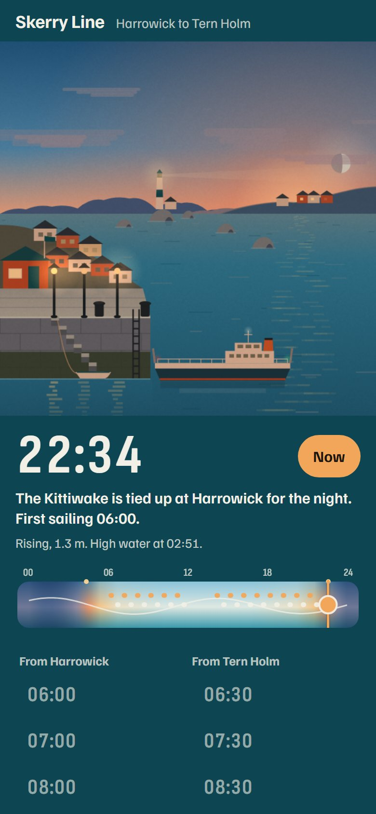

# Skerry Line

A ferry timetable you can drag through the day, true to the minute.

**[Try it](https://michaelshadpour.com/try/skerry-line)** · [Read the write-up](https://michaelshadpour.com/work/skerry-line)




## What it is

A small ferry company's site where the timetable is the picture. Drag the clock and the harbor follows: light, tide, lamps, and the ferry itself, placed by the same schedule you book from. Open it without touching anything and it shows the harbor at your own local time.

What to try:

- Drag the clock through the day. Drag anywhere on the day strip, or drag the picture sideways (half a day per picture width). The time, the sentence under it, the tide line, the light and the ferry all follow.
- Tap a sailing in the timetable and the clock glides to its departure. "Now" takes it back to your own time.
- With a keyboard, focus the day strip. The arrow keys move the clock five minutes, Shift with an arrow key or Page Up and Page Down move it an hour, and Home goes back to now.
- Book a crossing. The ticket shows the sailing, the fare and the tide at departure. It is a demo: nothing is charged or sent.
- Add `?attract=1` to the address for a self-running demo mode. One day (10 May 2026) plays in ten seconds, and the first tap or key press hands the page back to you.

## How it works

- **One pure function of the moment.** `sceneAt({ y, mo, d, minute })` in `src/model/scene.ts` returns everything the picture needs: the sun and moon, every color, the stars, the path of light on the water, each quay lamp and window, the lighthouse, the tide and the ferry. The renderer (`src/scene/draw.ts`) only draws that state, and the day strip paints its sky from the same function. The model never reads a clock itself. The page hands it the date and the minute.
- **The real sun for 58° north.** Harrowick shares Stornoway's latitude and longitude (58°13′N, 6°23′W) and the UK clock, so the NOAA solar equations can be checked against a published almanac. The tests compare sunrise and sunset with timeanddate.com's tables for Stornoway on five dates of 2026 (20 March, 10 May, 21 June, 23 September, 21 December) and require each within two minutes. The visitor's own clock time is shown as the harbor's clock time.
- **Colors are computed, never switched.** The palette is blended from the sun's elevation through night, the blue hour, sunset, the golden hour and full day. Lamps, windows, stars and the lighthouse fade over a few degrees of sun each, with small fixed offsets so the lamps do not come on together. A test walks every minute of six days across the year and checks that no color channel, lamp or window changes by more than 10 levels in a minute.
- **The ferry is where the timetable says.** The schedule is data (`src/model/schedule.ts`): from Harrowick on the hour, from Tern Holm on the half hour, 06:00 to 21:30 with a break at Harrowick from 11:55 to 14:00, 25 minutes across. Her position speeds up, cruises and slows down with continuous speed. A test steps every second of a day and over midnight and checks that she never moves further than her top speed allows. The ramp comes down only while she loads.
- **A tide built like a real one, but invented.** Two harmonic parts, lunar (M2) and solar (S2), so springs follow new and full moon and neaps the quarters. High and low waters are found numerically by bisection on the slope, and the tests check them against the model's own derivative, their alternation and spacing, and the fortnightly change in range. The page says plainly that the tide is invented for the demo.
- **Draws only when something changes.** While you drag or a glide runs, every frame. Otherwise four times a second while the lighthouse is lit, once a second while the ferry is crossing or her ramp is down, and once a minute when nothing moves. Nothing runs when the tab is hidden or the top section (picture, clock, day strip and timetable) is scrolled off screen.
- **The moon.** Its phase is real, from a known new moon and the synodic month. Its path is approximate: it follows the sun's path delayed by its age, on the celestial equator.
- **The picture.** The view looks south over the sound, so the sun comes up on the left, crosses, and sets on the right over Tern Holm. The *Kittiwake* is drawn as a double-ended car ferry with a ramp at each end, so she never has to turn around.
- **The self-running demo mode** pins the date to 10 May 2026 and starts at 20:45, the golden hour. Over the first two hours after midnight it blends the tide and the moon with their values a day later, so 24:00 meets 00:00 and the loop has no jump.
- **Hooks for tests.** `window.__skerry.state()` returns what the page shows (the time, the sentence, the tide line, the date, where the ferry is, the sun's elevation), and `window.__skerry.setMinute(minute)` sets the clock. `?date=YYYY-MM-DD&time=HH:MM` holds the clock at that moment. `?capture=1` stops the page's own loop and adds `window.__step(ms)`, which advances the self-running demo by that many milliseconds and draws.
- **Known limits.** Checked in Chromium only. The harbor clock is the visitor's clock, and on the two days a year the UK clocks change, the sun is computed with that day's noon offset. The moon's path is approximate. The tide is invented.

## Stack

Vite 6 and TypeScript (strict), no framework. Canvas 2D for the picture and the day strip, plain DOM for everything else. Vitest for the model, Playwright (Chromium) for the end-to-end tests. No runtime dependencies besides two self-hosted fonts.

## Run it

```
npm install
npm run dev          # http://127.0.0.1:5418
npm test             # Vitest: sun, timetable, ferry, tide, colors, text contrast
npm run build        # type check, then dist/ with relative paths, so it works from any subpath
npm run preview      # serves the folder at http://127.0.0.1:5418 (build first, then open /dist/)
```

For the end-to-end tests:

```
npx playwright install chromium
npm run test:e2e     # builds, then runs Playwright on dist/ at 390 x 844 (touch) and 1440 x 900
```

The end-to-end tests start their own static server on port 5418, which is also the dev server's port, so stop `npm run dev` first.

## Layout

- `src/`: `main.ts` (the clock, input, the draw loop, the timetable, booking, the self-running demo mode), `style.css`, and the two pictures in `assets/`.
- `src/model/`: the model. `scene.ts` (`sceneAt`), `sun.ts`, `tide.ts`, `schedule.ts`, `words.ts`.
- `src/scene/`: the Canvas 2D renderer for the harbor.
- `src/ui/`: the day strip, and the page's colors by the hour.
- `tests/`: Vitest tests for the model and the page tint. `e2e/`: Playwright end-to-end tests.
- `scripts/`: `serve.mjs`, the static server behind `npm run preview` and the end-to-end tests.
- `docs/`: the screenshots in this README.

## Credits and license

- Fonts: Familjen Grotesk (words) and Sofia Sans Condensed (times, fares and the timetable, in tabular figures), from `@fontsource-variable`, SIL Open Font License 1.1. Latin subset, weight axis only.
- Pictures: `src/assets/skerry-poster.webp` (beside the booking form) and `src/assets/skerry-harbor.webp` (in "The crossing") were generated with ChatGPT for this project. Everything in the harbor scene, the day strip, the favicon and the ticket is drawn in code.
- Concept project. Skerry Line is a fictional brand.
- Design and build: [Michael Shadpour](https://michaelshadpour.com).
- The code is under the MIT license. See [LICENSE](LICENSE).
